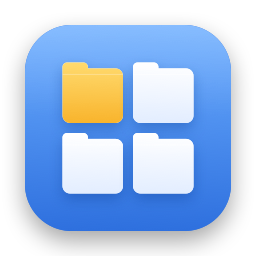
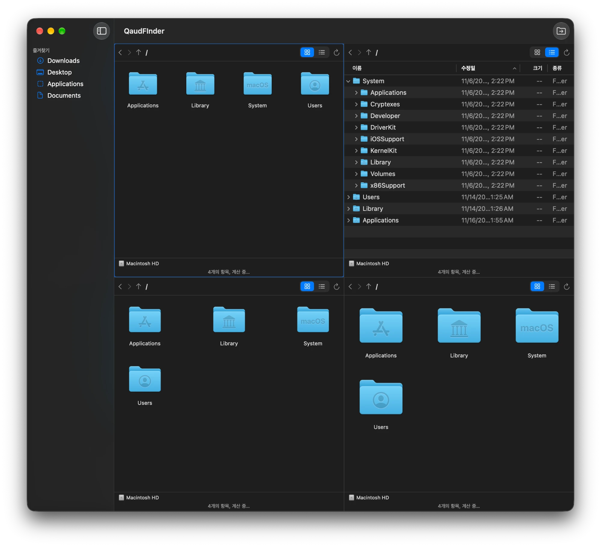

<p align="center">
  
</p>

<h1 align="center">QaudFInder</h1>

<p align="center">
  <b>한 창에 폴더 4개(2×2)</b>를 띄우는 가벼운 macOS 파일 탐색기<br>
  Swift 네이티브 · 외부 라이브러리 없음 · 약 2MB
</p>

<p align="center">
  <a href="README.md">English</a> | <b>한국어</b>
</p>

---

<p align="center">
  
</p>

## 왜 QaudFInder인가요?

Finder는 창(또는 탭) 하나에 폴더 하나만 보여 줍니다. 여러 폴더 사이에서 파일을 정리하다 보면 창을 이리저리 옮기게 되죠.
QaudFInder는 한 창을 **칸 4개**로 나눠 칸마다 다른 폴더를 띄웁니다. 폴더들을 한눈에 보면서 파일을 바로 옮길 수 있어요.

> **이름에 대해** — "QaudFInder"는 *QuadFinder*를 잘못 입력한 데서 시작했습니다. 흔한 이름의 앱들과 구별되는 작은 표시로 일부러 그대로 두었어요.

## 기능

**화면 배치**
- 2×2 칸, 경계선을 끌어 크기 조절. 칸마다 폴더·보기 방식·정렬을 기억
- 같은 폴더를 보는 이웃한 두 칸 **병합** (두 칸의 위쪽 막대를 `⌘`+클릭 → "병합하기")
- 활성 칸 테두리 표시, `Tab` / `⇧Tab`으로 칸 이동
- 접을 수 있는 사이드바 + 즐겨찾기 (끌어 놓기·우클릭으로 추가, 끌어서 순서 변경)
- 여러 창(`⌘N`) — 새 창은 설정한 시작 폴더로 시작
- **설정 창**(`⌘,` 또는 오른쪽 위 톱니바퀴): 칸별 시작 폴더, 보기, 파일 조작, 사이드바, **단축키 바꾸기**, 초기화

**탐색**
- 리스트 보기: 열 제목 클릭 정렬(이름/수정일/크기/종류), **폴더 펼치기**(`›`, `→` / `←`)
- 아이콘 보기: 아이콘 보기 버튼을 `⌘`+클릭하면 **아이콘 크기**(50~300%)와 **격자 간격**(50~150%) 슬라이더 (칸별)
- 사진·PDF·동영상·문서의 **내용 미리보기**(썸네일)
- `Space`로 훑어보기, 띄운 채 방향키로 다른 파일 보기
- 끌어서 범위 선택, 이름 입력으로 찾기, 경로 막대
- 칸 위쪽의 **경로를 더블클릭**(또는 `⇧⌘G`)해서 경로를 입력해 이동
- 상태줄에 **지금 폴더가 차지하는 용량** 표시 (화면 뒤에서 계산)
- 칸별 숨김 파일 보기(`⇧⌘.`)
- 폴더 내용이 바뀌면 자동 새로고침

**파일 조작**
- 칸 → 칸 끌어 놓기: 기본은 **복사**, 끌기 시작한 뒤 `⌘`를 누르면 **이동**
- 폴더를 `⌥` 누른 채 다른 칸에 놓으면 → 복사하지 않고 그 칸이 **그 폴더로 이동**
- 복사·붙여넣기·옮기기(`⌘C`, `⌘V`, `⌥⌘V`), 이름 바꾸기(`Return`), 새 폴더(`⇧⌘N`), 경로 복사(`⌥⌘C`)
- 화면 뒤에서 복사, 진행률·대기열·취소
- 우클릭 메뉴: 열기, **다음으로 열기**, 훑어보기, 이름 바꾸기, 복사, 휴지통으로 이동, 경로 복사, Finder에서 보기, 사이드바에 추가, **서비스**(다른 앱·단축어가 제공하는 기능)
- 즐겨찾기는 이름을 바꾸거나 옮긴 폴더를 따라가고, 휴지통으로 간 폴더는 자동으로 정리 (연결이 끊긴 외장 디스크의 폴더는 흐리게 남김)

### 안전이 먼저
QaudFInder는 **파일을 완전히 삭제하지 않습니다.** 파일을 없애는 동작은 모두 휴지통을 거칩니다.
`⌘⌫`, 취소한 복사(덜 복사된 파일), 다른 디스크로 옮긴 뒤의 원본 모두 휴지통으로 가요. 언제든 휴지통에서 "되돌려 놓기"로 살릴 수 있습니다.
Finder 등 바깥으로 끌어낼 때는 항상 복사입니다.

## 단축키

**설정 → 단축키**에서 아래 단축키 대부분을 바꿀 수 있습니다(기본값 기준).

| 단축키 | 동작 |
|---|---|
| 더블클릭 / `⌘↓` / `⌘O` | 열기 (폴더는 들어가기) |
| `⌘↑` | 상위 폴더 |
| `⇧⌘G` / 경로 더블클릭 | 폴더로 이동 (경로 입력) |
| `Tab` / `⇧Tab` | 다음 / 이전 칸 |
| `Space` | 훑어보기 |
| `Return` | 이름 바꾸기 |
| `⇧⌘N` | 새 폴더 |
| `⌘⌫` | 휴지통으로 이동 |
| `⌘C` / `⌘V` / `⌥⌘V` | 복사 / 붙여넣기 / 여기로 옮기기 |
| `⌥⌘C` | 경로 복사 |
| `⇧⌘.` | 숨김 파일 보기 / 가리기 |
| `⌃⌘S` | 사이드바 보기 / 가리기 |
| `→` / `←` (리스트 보기) | 폴더 펼치기 / 접기 |
| 위쪽 막대 `⌘`+클릭 | 병합할 칸 선택 (`esc`로 취소) |
| 아이콘 보기 버튼 `⌘`+클릭 | 아이콘 크기·격자 간격 슬라이더 |
| `⌘,` | 설정 |

## 설치

1. [**Releases**](../../releases) 페이지에서 `QaudFInder.zip`을 내려받아 압축을 풉니다.
2. `QaudFInder.app`을 **응용 프로그램** 폴더로 옮깁니다.
3. **처음 실행할 때:** 개인 취미 프로젝트라 Apple 인증(공증)을 받지 않아, 처음 한 번은 macOS가 실행을 막습니다.
   - **시스템 설정 → 개인정보 보호 및 보안**을 열고, 아래쪽 QaudFInder 안내 옆의 **그래도 열기**를 누르세요.
   - (예전 macOS에서는 앱을 우클릭 → **열기**로도 됩니다.)
4. 데스크탑·문서·다운로드 폴더 접근을 물어보면 **허용**을 누릅니다.

**필요 환경:** macOS 27.2 이상, Apple 실리콘 Mac

## 직접 빌드하기

Xcode 27.2 이상이 필요합니다. 외부 패키지는 없습니다.

```bash
git clone https://github.com/Tissant/QaudFInder.git
cd QaudFInder
open QaudFInder.xcodeproj      # Xcode에서 ⌘R
```

Release로 빌드해서 `/Applications`에 한 번에 설치하려면:

```bash
./Tools/install.sh
```

빌드 → 실행 중인 앱 종료 → 예전 버전은 휴지통으로 → 새 버전 설치까지 자동으로 합니다.

## 프로젝트 구조

```
QaudFInder/
├── QaudFInderApp.swift      앱 시작점, 메뉴, 복사 중 종료 확인
├── Models/
│   ├── PaneModel.swift        칸 하나: 이동, 선택, 정렬, 파일 조작, 폴더 감시
│   ├── CopyQueue.swift        백그라운드 복사 대기열·진행률 (copyfile)
│   ├── SidebarModel.swift     즐겨찾기 (북마크로 저장, 사라진 폴더 정리)
│   ├── AppSettings.swift      설정 창의 값
│   ├── Shortcuts.swift        바꿀 수 있는 단축키
│   ├── ThumbnailCache.swift   파일 내용 미리보기 (QuickLookThumbnailing)
│   └── FileItem.swift
└── Views/
    ├── ContentView.swift      창 전체: 사이드바 + 2×2 칸 + 병합
    ├── PaneView.swift         칸 하나: 위쪽 막대, 경로 막대, 상태줄
    ├── FileTableView.swift    리스트 보기 (NSOutlineView)
    ├── FileGridView.swift     아이콘 보기 (NSCollectionView)
    ├── ListSupport.swift      단축키, 우클릭 메뉴, 끌어 놓기 규칙, 이름 바꾸기, 훑어보기
    ├── PathField.swift        위쪽 막대의 경로 표시·입력칸
    ├── SettingsView.swift     설정 창 (⌘,)
    ├── SidebarView.swift, IconSizePopover.swift, CopyProgressBar.swift
Tools/
├── install.sh               Release 빌드 → /Applications 설치
└── make-icon.swift          앱 아이콘을 코드로 그림
```

**Swift, SwiftUI, AppKit**만 사용했습니다. 외부 패키지는 없습니다.

## 개발 과정

이 앱을 어떻게 기획하고 버전별로(v1 → v7 → 1.1.0) 만들었는지, 어떤 문제를 만나 어떻게 풀었는지 정리했습니다.
**[docs/DEVLOG.ko.md](docs/DEVLOG.ko.md)** (한국어) · [docs/DEVLOG.md](docs/DEVLOG.md) (English)

기획·테스트는 [Tissant](https://github.com/Tissant), 구현은 [Claude Code](https://claude.com/claude-code)와 함께 했습니다.

## 라이선스

[MIT](LICENSE) © 2026 Tissant
