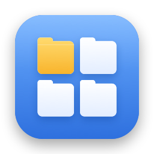
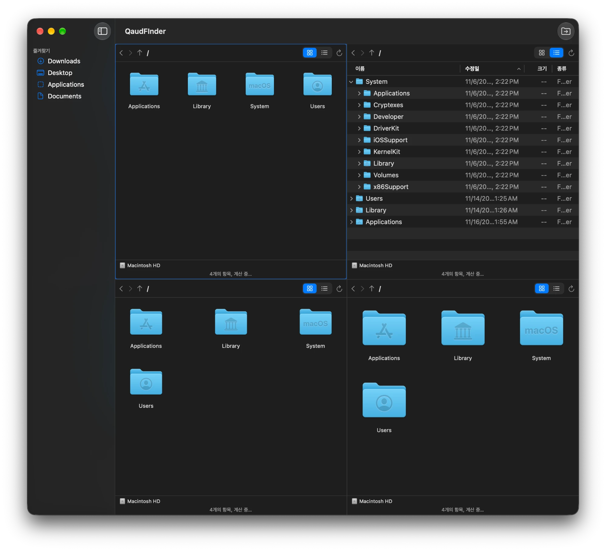

<p align="center">
  
</p>

<h1 align="center">QaudFInder</h1>

<p align="center">
  A lightweight macOS file manager that shows <b>several folders in one window</b> (up to 6 panes).<br>
  Native Swift · No dependencies · ~2 MB
</p>

<p align="center">
  <b>English</b> | <a href="README.ko.md">한국어</a>
</p>

---

<p align="center">
  
</p>

## Why QaudFInder?

Finder shows one folder per window (or per tab). When you sort files between several folders, you end up juggling windows.
QaudFInder splits one window into **several panes (up to 6)**, each with its own folder, so you can see and move files between them at a glance.

> **About the name** — "QaudFInder" started as a typo of *QuadFinder*. It stayed on purpose, as a small mark that sets it apart from the many apps with the usual name.

## Features

**Layout**
- **Free splitting**: ⌘-click the top bar of the active pane → **Split Left/Right** or **Split Top/Bottom** (up to 6 panes)
- **Merge**: ⌘-click a pane next to the active pane → *Merge*. Any two panes that form a rectangle together, even with different folders, down to a single pane
- Draggable dividers. The split layout, divider positions, and each pane's folder, view mode and sort order are remembered
- **Startup layout**: last layout, or a grid of 1–3 columns × 1–3 rows (up to 6 panes) with a start folder per pane
- Active pane highlight, move between panes with `Tab` / `⇧Tab`
- Collapsible sidebar with favorites (add by drag & drop or right-click, reorder by dragging)
- Multiple windows (`⌘N`) — new windows start with your chosen grid and start folders
- **Settings window** (`⌘,` or the gear button, top right): startup layout, start folder per pane, view, file operations, sidebar, **custom keyboard shortcuts**, reset

**Browsing**
- List view with sortable columns (Name / Date Modified / Size / Kind) and **expandable folders** (`›` disclosure, `→` / `←`)
- Icon view: ⌘-click the icon-view button for **icon size** (50–300%) and **grid spacing** (50–150%) sliders (per pane)
- **File content previews** (thumbnails) for images, PDFs, videos, documents
- Quick Look with `Space`; keep it open and use the arrow keys to browse
- Rubber-band selection, type-to-select, path bar
- **Double-click the path** at the top of a pane (or press `⇧⌘G`) to type a path and go there
- Status bar shows the **size of the current folder** (calculated in the background, active pane only)
- Show hidden files per pane (`⇧⌘.`)
- Auto-refresh when files change in the current folder

**File operations**
- Drag & drop between panes: **copy** by default, **move** if you press `⌘` while dragging
- Drop a folder with `⌥` held → the target pane **opens that folder** instead of copying
- Copy / paste / move (`⌘C`, `⌘V`, `⌥⌘V`), rename (`Return`), new folder (`⇧⌘N`), copy path (`⌥⌘C`)
- Background copying with a progress bar, queue and cancel
- Context menu: Open, **Open With**, Quick Look, Rename, Copy, Move to Trash, Copy Path, Show in Finder, Add to Sidebar, **Services** (actions from other apps and Shortcuts)
- Favorites follow renamed or moved folders; folders moved to the Trash are removed automatically (folders on a disconnected external drive stay, dimmed)

### Safety first
QaudFInder **never deletes files permanently.** Everything that removes a file goes to the Trash:
`⌘⌫`, cancelled copies (partial files), and the original after a move across disks. You can always use *Put Back* in the Trash.
Dragging files *out* to Finder or other apps is always a copy.

## Keyboard shortcuts

Most of these can be changed in **Settings → Shortcuts** (defaults shown).

| Shortcut | Action |
|---|---|
| Double-click / `⌘↓` / `⌘O` | Open (enter folder) |
| `⌘↑` | Enclosing folder |
| `⇧⌘G` / double-click the path | Go to Folder (type a path) |
| `Tab` / `⇧Tab` | Next / previous pane |
| `Space` | Quick Look |
| `Return` | Rename |
| `⇧⌘N` | New folder |
| `⌘⌫` | Move to Trash |
| `⌘C` / `⌘V` / `⌥⌘V` | Copy / Paste / Move here |
| `⌥⌘C` | Copy path |
| `⇧⌘.` | Show / hide hidden files |
| `⌃⌘S` | Show / hide sidebar |
| `→` / `←` (list view) | Expand / collapse folder |
| `⌘`-click top bar | Active pane: split buttons / adjacent pane: merge button (`esc` to cancel) |
| `⌘`-click icon-view button | Icon size & grid spacing sliders |
| `⌘,` | Settings |

## Installation

1. Download `QaudFInder.zip` from the [**Releases**](../../releases) page and unzip it.
2. Move `QaudFInder.app` to your **Applications** folder.
3. **First launch:** the app is not notarized by Apple (it's a free hobby project), so macOS will block it the first time.
   - Open **System Settings → Privacy & Security**, scroll down and click **Open Anyway** next to the QaudFInder message.
   - (On older macOS versions you can also right-click the app → **Open**.)
4. Allow access when macOS asks about your Desktop, Documents or Downloads folders.

**Requirements:** macOS 27.2 or later on an Apple silicon Mac.

## Build from source

Requires Xcode 27.2 or later. No package dependencies.

```bash
git clone https://github.com/Tissant/QaudFInder.git
cd QaudFInder
open QaudFInder.xcodeproj      # then press ⌘R in Xcode
```

Or build a Release version and install it into `/Applications` in one step:

```bash
./Tools/install.sh
```

The script builds, quits a running copy, moves the previous version to the Trash, and installs the new one.

## Project structure

```
QaudFInder/
├── QaudFInderApp.swift      App entry, menus, quit confirmation during copies
├── Models/
│   ├── PaneLayout.swift       Pane layout tree: split, merge, positions, Tab order
│   ├── PaneModel.swift        One pane: navigation, selection, sorting, file operations, folder watching
│   ├── CopyQueue.swift        Background copy queue with progress (copyfile)
│   ├── SidebarModel.swift     Favorites (stored as bookmarks, cleans up missing folders)
│   ├── AppSettings.swift      Values from the Settings window
│   ├── Shortcuts.swift        Customizable keyboard shortcuts
│   ├── ThumbnailCache.swift   File content previews (QuickLookThumbnailing)
│   └── FileItem.swift
└── Views/
    ├── ContentView.swift      Window: sidebar + pane layout + split/merge
    ├── PaneLayoutView.swift   Draws the panes and draggable dividers
    ├── PaneView.swift         One pane: top bar, path bar, status bar
    ├── FileTableView.swift    List view (NSOutlineView)
    ├── FileGridView.swift     Icon view (NSCollectionView)
    ├── ListSupport.swift      Shortcuts, context menu, drop rules, rename, Quick Look
    ├── PathField.swift        Path display / input field in the top bar
    ├── SettingsView.swift     Settings window (⌘,)
    ├── StartLayoutPicker.swift Startup layout (grid + preview)
    ├── SidebarView.swift, IconSizePopover.swift, CopyProgressBar.swift
Tools/
├── install.sh               Release build → /Applications
└── make-icon.swift          Draws the app icon in code
```

Built with **Swift, SwiftUI and AppKit** only — no third-party packages.

## Development log

How this app was planned and built, version by version (v1 → v7 → 1.1.0), including the problems we hit and how they were solved:
**[docs/DEVLOG.md](docs/DEVLOG.md)** (English) · [docs/DEVLOG.ko.md](docs/DEVLOG.ko.md) (한국어)

QaudFInder was designed and tested by [Tissant](https://github.com/Tissant) and implemented with [Claude Code](https://claude.com/claude-code).

## License

[MIT](LICENSE) © 2026 Tissant
